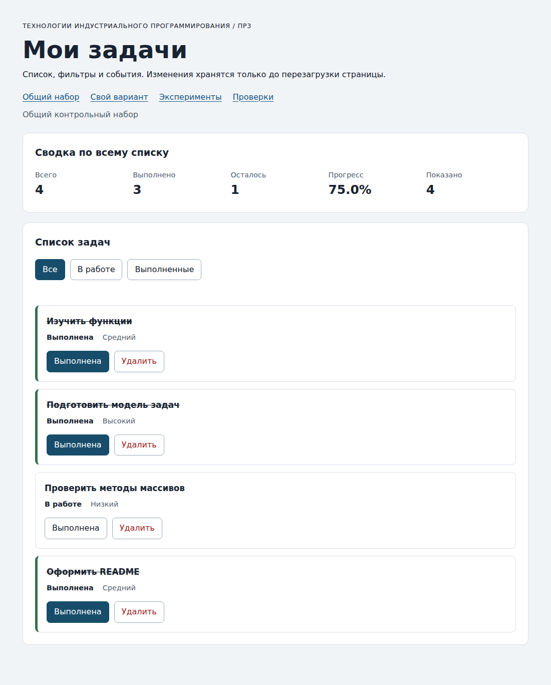
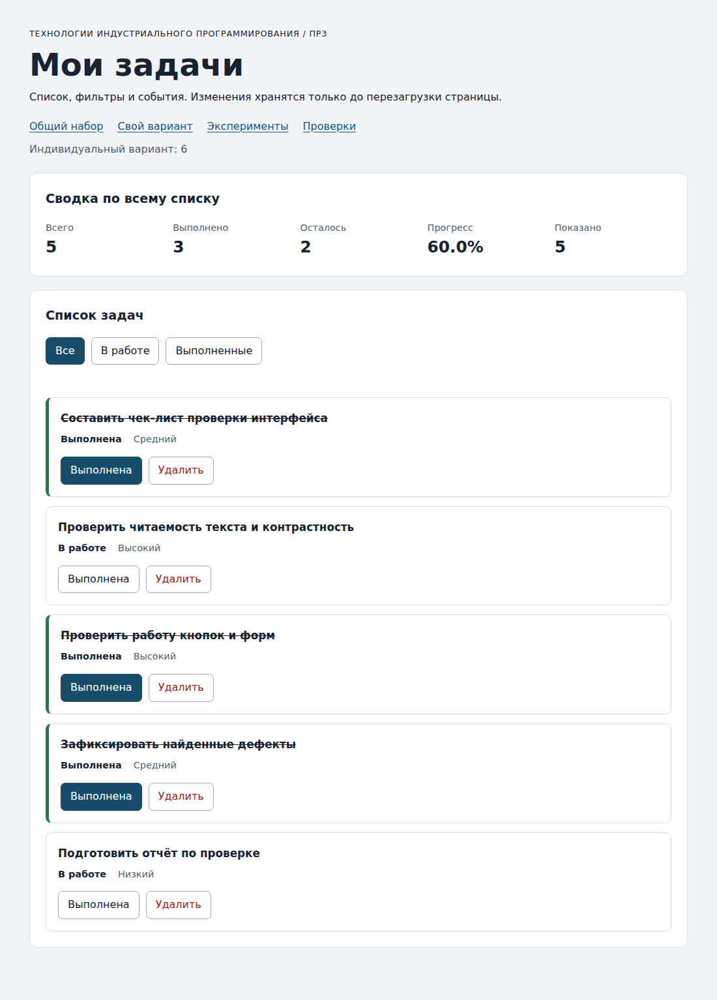

# Практическая работа № 3. Работа с DOM и событиями

## Данные работы

| Поле | Значение |
|---|---|
| Имя | Чижова Виолетта |
| Группа | ЭФБО-13-25 |
| Вариант из ПР2 | 6 («Проверка пользовательского интерфейса») |
| Node.js | v24.21.0 |
| Браузер | Google Chrome 155.0.8059.86 (официальная сборка, arm64) |
| Операционная система | macOS 26.2 (сборка 25C56) |

## Запуск

Рабочая папка: `practice-03` внутри личного репозитория.

```bash
npm run check:service
npm start
```

Устанавливать зависимости через `npm install` не требуется. Для PowerShell при блокировке `npm.ps1` доступны `npm.cmd` и прямые команды `node` (`node checks/service.checks.js`, `node tools/serve.mjs`).

```text
http://127.0.0.1:5503/
http://127.0.0.1:5503/index.html?dataset=variant
http://127.0.0.1:5503/examples/dom-events.html
http://127.0.0.1:5503/checks.html
```

Остановка сервера: `Ctrl+C`. Если порт 5503 занят, запускается `node tools/serve.mjs 5504`, и во всех адресах используется `5504`.

## Что перенесено из ПР2

Файлы `src/task-service.js` и `src/data.js` скопированы из `practice-02/src/` без изменений (побайтовое совпадение проверено). После переноса запущено `npm run check:service`: **35 из 35 проверок пройдено**, ошибок нет. Исправлений в реализации ПР2 не потребовалось. `src/data.js` содержит данные варианта 6 (`variantTasks`, `variantNumber = 6`) из ПР2.

Фактический вывод (последние строки):

```text
OK: 34. Общий сценарий и все промежуточные сводки
OK: 35. Работа с другим набором, без зависимости от demoTasks

Проверок пройдено: 35; не пройдено: 0.
```

## Эксперименты

Прогнозы записаны до запуска, результаты получены на странице `examples/dom-events.html` (значения из Console и из DOM).

| № | До запуска: прогноз | После запуска: результат | Объяснение |
|---|---|---|---|
| 1. Отсутствующий элемент и коллекция | `querySelector` вернёт `null`, `querySelectorAll` для отсутствующего класса даст пустую коллекцию длиной 0; к `null` обратиться нельзя, к пустой коллекции можно | `Отсутствующий элемент: null`; `Пустая коллекция: 0`. Обращение `missing.textContent` даёт `TypeError: Cannot read properties of null (reading 'textContent')`; у пустого `NodeList` `forEach` выполняется без ошибки (0 вызовов) | `querySelector` возвращает единственный элемент или `null`, поэтому перед обращением к свойствам нужна проверка. `querySelectorAll` всегда возвращает `NodeList` (возможно, пустой), с ним можно работать без проверки на `null`. |
| 2. dataset и числовой id | `dataset.taskId` будет строкой `"23"`, после `Number` — числом `23` | `dataset.taskId: 23 string`; `Числовой id: 23` (тип number) | Значения `data-*` всегда строки. Для сравнения с числовым `id` из данных строку нужно явно преобразовать и проверить результат. |
| 3. Статический NodeList | Сохранённый `initialItems` останется длиной 1, новый `querySelectorAll` вернёт 2, затем 3 | После первого нажатия: `Старый NodeList: 1`, `Новый querySelectorAll: 2`; после второго: `1` и `3`. Всего в списке 3 элемента `li` | `querySelectorAll` возвращает статический снимок на момент вызова. Добавленные позже элементы в него не попадают, поэтому после изменения DOM нужно выполнить поиск заново. |
| 4. Строка с HTML-разметкой | В заголовке появится сама строка вместе с тегом `<strong>`, форматированного слова не будет | В заголовке отображается `<strong>Это текст, а не HTML</strong>`; `children.length = 0`; `innerHTML` = `&lt;strong&gt;Это текст, а не HTML&lt;/strong&gt;` | `textContent` записывает строку как текст, а специальные символы экранируются. Поэтому названия задач в приложении выводятся безопасно: разметка в названии не превращается в элементы. |
| 5. Распространение события | При нажатии на вложенный `span`: сначала обработчик захвата на контейнере (фаза 1), затем обработчик кнопки (при всплытии, фаза 3), затем обработчик контейнера при всплытии (фаза 3) | Журнал: `1. phase=1; target=lab-label; currentTarget=lab-card`, `2. phase=3; target=lab-label; currentTarget=lab-button`, `3. phase=3; target=lab-label; currentTarget=lab-card` | `target` — самый вложенный элемент, по которому нажали (`span`), `currentTarget` — элемент, чей обработчик сейчас выполняется. Событие всплывает от `span` к предкам, поэтому обработчик кнопки и обработчик контейнера получают нажатие на вложенный элемент. На этом основано делегирование: один обработчик на `ul` обрабатывает кнопки всех карточек. |

**Точка останова (дополнительно к эксперименту 5).** В `examples/dom-events.js` точка останова поставлена на строке 25 (`record(event);` в обработчике кнопки). Нажатие выполнено на вложенный текст кнопки (`span#lab-label`). Значения в момент остановки получены через отладчик браузера:

| Выражение | Значение |
|---|---|
| `event.target.tagName` / `event.target.id` | `SPAN` / `lab-label` |
| `event.currentTarget.tagName` / `event.currentTarget.id` | `BUTTON` / `lab-button` |
| `event.eventPhase` | `3` (всплытие) |
| `event.target === event.currentTarget` | `false` |

Значения совпали с прогнозом по журналу: `target` — вложенный `span`, `currentTarget` — кнопка, чей обработчик выполняется.

## Организация кода

| Файл | Ответственность |
|---|---|
| `src/data.js` | Общий набор `demoTasks`, `variantTasks` и `variantNumber`. Ни DOM, ни изменения списка. |
| `src/task-service.js` | Прикладные функции ПР2 (`createTask`, `findTaskById`, `getTaskStats`, `addTask`, `setTaskCompleted`, `renameTask`, `removeTask` и др.). Не обращается к `document`, не хранит глобальный список. |
| `src/task-selectors.js` | `getVisibleTasks(tasks, filter)`: возвращает новый массив для `all`, `pending`, `completed`, не меняя входные записи. |
| `src/task-view.js` | `createTaskElement`, `renderTaskList`, `renderSummary`, `renderEmptyState`: создание и обновление DOM; все значения выводятся через `textContent`. Состояние не меняется, обработчики не назначаются. |
| `src/main.js` | Состояние (`currentTasks`, `currentFilter`), `renderApp`, делегированные обработчики `handleTaskListClick` и `handleFilterClick`, вызовы сервиса. |

- **Полный список и фильтр хранятся в `main.js`:** `currentTasks` (весь список) и `currentFilter` (выбранный режим). Отфильтрованная выборка в состоянии не хранится, она вычисляется в `renderApp` при каждой отрисовке.
- **Событие обрабатывается в `main.js`:** на `ul#task-list` и `#task-filters` подписка выполняется один раз, при отрисовке обработчики не назначаются. Кнопка находится через `closest`, поэтому нажатие на вложенный `span` работает.
- **Сводка вычисляется** в `renderSummary` через `getTaskStats(currentTasks)` по всему списку; «Показано» берётся из длины выборки.
- **Идентификатор** карточки читается из `dataset.taskId`, преобразуется через `Number` и проверяется как положительное безопасное целое (дополнительно `String(id)` должен совпасть с исходной строкой, чтобы значения вида `4abc`, ` 4`, `04` не принимались). Изменение данных выполняют только функции ПР2.
- **При отказе** операции сообщение выводится в `#operation-message` через `textContent`, массив не заменяется. Сообщение очищается после успешного действия или выбора фильтра.

## Общий сценарий

Сценарий пройден реальными кликами по приложению (общий набор, без `dataset=variant`). Ожидания взяты из раздела 6.5 методички, фактические значения прочитаны из DOM после каждого шага. Столбец «Показано» равен длине массива в столбце «Видимые id».

| Шаг | Действие | Видимые id | Всего | Выполнено | Осталось | Прогресс | Показано | Сообщение | Совпало с ожиданием |
|---:|---|---|---|---|---|---|---|---|---|
| 0 | Исходный набор, «Все» | `[1, 4, 7, 10]` | 4 | 2 | 2 | 50.0% | 4 | — | Да |
| 1 | Выбрать «В работе» | `[4, 7]` | 4 | 2 | 2 | 50.0% | 2 | — | Да |
| 2 | Отметить выполненной id = 4 | `[7]` | 4 | 3 | 1 | 75.0% | 1 | — | Да |
| 3 | Выбрать «Все» | `[1, 4, 7, 10]` | 4 | 3 | 1 | 75.0% | 4 | — | Да |
| 4 | Удалить id = 7 | `[1, 4, 10]` | 3 | 3 | 0 | 100.0% | 3 | — | Да |
| 5 | Выбрать «В работе» | `[]` | 3 | 3 | 0 | 100.0% | 0 | Нет задач по выбранному фильтру. | Да |
| 6 | Выбрать «Все», переключить id = 1 | `[1, 4, 10]` | 3 | 2 | 1 | 66.7% | 3 | — | Да |
| 7 | Последовательно удалить 1, 4, 10 | `[]` | 0 | 0 | 0 | 0.0% | 0 | Список задач пуст. | Да |

После перезагрузки: возвращается шаг 0 (`[1, 4, 7, 10]`, всего 4, выполнено 2, прогресс 50.0%). Отсутствие сохранения в ПР3 ожидаемо, сохранение относится к ПР4. На шаге 5 отображается сообщение «Нет задач по выбранному фильтру.», на шаге 7 — «Список задач пуст.».



## Проверки

Фактический вывод готовых проверок. Проверки функций ПР2 (`npm run check:service`):

```text

> tip-js-practice-03@1.0.0 check:service
> node checks/service.checks.js

OK: 01. Создание задачи с явным приоритетом
OK: 02. Приоритет по умолчанию
OK: 03. Удаление краевых пробелов без изменения внутренних
OK: 04. Граничные длины названия и положительный безопасный id
OK: 05. Некорректные названия при создании
OK: 06. Некорректные идентификаторы при создании
OK: 07. Все допустимые приоритеты и отклонение недопустимых
OK: 08. Каждый вызов createTask возвращает новый объект
OK: 09. Поиск по id, а не по индексу
OK: 10. Отсутствующая задача и пустой массив при поиске
OK: 11. Поиск не преобразует строковый id в число
OK: 12. Получение невыполненных задач
OK: 13. Пустой список, все выполнены и все не выполнены
OK: 14. Названия в исходном порядке и пустой список
OK: 15. Сводка по общему набору
OK: 16. Сводка по пустому списку
OK: 17. Сводка: ничего не выполнено и выполнено всё
OK: 18. Процент остаётся числом без предварительного округления
OK: 19. Добавление в конец без изменения входного массива
OK: 20. Добавление в пустой список с приоритетом по умолчанию
OK: 21. Повторяющийся id отклоняется
OK: 22. Добавление не обходит проверки createTask
OK: 23. Изменение completed в обе стороны
OK: 24. completed принимает только boolean
OK: 25. Некорректный или отсутствующий id при изменении статуса
OK: 26. Повторная установка статуса создаёт новый результат
OK: 27. Переименование сохраняет остальные поля
OK: 28. Проверки названия при переименовании
OK: 29. Некорректный или отсутствующий id при переименовании
OK: 30. Удаление по id с сохранением порядка
OK: 31. Удаление единственной записи
OK: 32. Некорректный, отсутствующий id и удаление из пустого списка
OK: 33. Входные объекты не изменяются ни одной операцией
OK: 34. Общий сценарий и все промежуточные сводки
OK: 35. Работа с другим набором, без зависимости от demoTasks

Проверок пройдено: 35; не пройдено: 0.
```

Проверки браузерного интерфейса (`http://127.0.0.1:5503/checks.html`, блок «Текстовый протокол»; ошибок в Console не было):

```text
OK: Фильтр all возвращает новый массив в исходном порядке
OK: Фильтр pending выбирает невыполненные задачи
OK: Фильтр completed выбирает выполненные задачи
OK: Все три фильтра работают с пустым списком
OK: Фильтрация не меняет входные записи и их порядок
OK: Карточка — li.task-card с числовым id в dataset
OK: Статус невыполненной карточки и aria-pressed согласованы
OK: Статус выполненной карточки и aria-pressed согласованы
OK: В карточке две обычные кнопки с вложенными подписями
OK: Все приоритеты отображаются по установленному словарю
OK: Название с разметкой отображается текстом
OK: Отрисовка списка создаёт карточки в исходном порядке
OK: Повторная отрисовка не накапливает карточки
OK: Контейнер списка и его обработчик сохраняются
OK: Отрисовка пустого массива очищает прежние карточки
OK: Сводка считается по всему списку, отдельно выводится Показано
OK: Пустая сводка не содержит NaN и Infinity
OK: Сообщение для полностью пустого списка
OK: Сообщение для пустого результата фильтра
OK: Появление карточек скрывает прежнее пустое состояние
OK: Приложение: начальный набор и сводка
OK: Приложение: фильтр срабатывает по клику на вложенный span
OK: Приложение: активный фильтр отмечен классом и aria-pressed
OK: Приложение: фильтрация не удаляет скрытые задачи
OK: Приложение: переключение по id, а не индексу массива
OK: Приложение: выполненная задача исчезает из фильтра В работе
OK: Приложение: удаление изменяет данные, а не только DOM
OK: Приложение: клик по названию не изменяет данные
OK: Приложение: после перерисовок одно нажатие — одно изменение
OK: Приложение: удаление всех записей и нулевая сводка
OK: Приложение: нет совпадений — не то же самое, что нет задач
OK: Приложение: неизвестный числовой id не меняет данные
OK: Приложение: id 4abc не превращается в 4
OK: Приложение: неизвестное действие игнорируется
OK: Приложение: после изменения сохраняется клавиатурный фокус
OK: Приложение: новая загрузка возвращает исходное состояние

Всего: 36. Пройдено: 36. Ошибок: 0.
```

### Собственные проверки

Ожидания сформулированы по правилам из методички до запуска, фактические значения прочитаны из DOM (формат: видимые id; всего / выполнено / осталось / прогресс / показано).

| Проверка | Исходное состояние и действие | Ожидание | Фактический результат | Итог |
|---|---|---|---|---|
| 1. Единственная задача (граничное состояние) | Общий набор. Удалены id 1, 4, 7, остаётся `id = 10` (выполнена). Затем: переключить 10; фильтр «Выполненные»; фильтр «В работе»; «Все» и удалить 10 | Осталась одна карточка: 1 / 1 / 0 / 100.0%. После переключения 1 / 0 / 1 / 0.0%. Фильтр «Выполненные»: пусто, сообщение «Нет задач по выбранному фильтру.». «В работе»: одна карточка. После удаления последней: 0 / 0 / 0 / 0.0% и «Список задач пуст.» | После удалений: `[10]`, 1 / 1 / 0 / 100.0% / 1. После переключения: 1 / 0 / 1 / 0.0% / 1. «Выполненные»: `[]`, сообщение «Нет задач по выбранному фильтру.». «В работе»: `[10]`. После удаления последней: `[]`, 0 / 0 / 0 / 0.0% / 0, «Список задач пуст.» | Пройдено |
| 2. Название длиной 100 (граничное значение) | Карточка создана через `createTaskElement` с названием из 100 символов «Ж», добавлена в список | Название выводится полностью (100 символов), горизонтальной прокрутки у страницы нет | Длина текста: 100, совпадает с исходной строкой; `scrollWidth` заголовка 922 при `clientWidth` 922; горизонтального переполнения страницы нет | Пройдено |
| 3. Быстрые переключения подряд (событие и повторная отрисовка) | Общий набор, 5 нажатий подряд на «Выполнена» у `id = 4`, затем ещё одно | После 5 нажатий (нечётное число) задача выполнена: 4 / 3 / 1 / 75.0%; карточек 4. После 6-го: 4 / 2 / 2 / 50.0%; карточек 4 (без дублей) | После 5: `[1, 4, 7, 10]`, 4 / 3 / 1 / 75.0% / 4, карточек 4. После 6: 4 / 2 / 2 / 50.0% / 4, карточек 4 | Пройдено |
| 4. Действие после перехода между фильтрами и неизменность `demoTasks` | Общий набор. «Выполненные» → переключить `id = 1` → «В работе» → «Все» → удалить `id = 7`. После этого прочитать экспортированный `demoTasks` | После переключения 1 в фильтре «Выполненные» остаётся `[10]`, 4 / 1 / 3 / 25.0%. «В работе»: `[1, 4, 7]`. «Все»: четыре карточки. После удаления 7: `[1, 4, 10]`, 3 / 1 / 2 / 33.3%. Экспортированный `demoTasks` не изменился | «Выполненные» → после переключения: `[10]`, 4 / 1 / 3 / 25.0% / 1. «В работе»: `[1, 4, 7]`. «Все»: `[1, 4, 7, 10]`. После удаления 7: `[1, 4, 10]`, 3 / 1 / 2 / 33.3% / 3. `demoTasks` после действий совпал с исходным (id, названия, `completed`, приоритеты) | Пройдено |
| 5. Ошибочные состояния | Общий набор. В DOM у карточки `id = 4` подменён `data-task-id`: сначала на `777`, затем на `4abc`; затем у кнопки задано неизвестное действие `archive`; клик по названию карточки | Для `777`: сообщение об отсутствии задачи, данные не изменены. Для `4abc`: сообщение о некорректном идентификаторе, `4abc` не превращается в `4`. Выбор фильтра очищает сообщение. Неизвестное действие и клик по названию данные не меняют | `777`: сообщение «Задача с идентификатором 777 не найдена.», показатели 4 / 2 / 2 / 50.0% / 4. После выбора фильтра: сообщение пустое, `[1, 4, 7, 10]`. `4abc`: сообщение «Некорректный идентификатор задачи: "4abc".», показатели 4 / 2 / 2 / 50.0% / 4. `archive`: 4 / 2 / 2 / 50.0% / 4, сообщение пустое. Клик по названию: 4 / 2 / 2 / 50.0% / 4 | Пройдено |
| 6. Клавиатура и фокус | Общий набор. Фокус на кнопке «Выполнена» у `id = 4`, Enter, затем Space. Затем фокус на фильтре «В работе», Enter; фокус на «Удалить» у `id = 7`, Enter | После Enter задача выполнена (4 / 3 / 1 / 75.0%), фокус остаётся на кнопке «Выполнена» той же карточки. После Space — снова 50.0%. Фильтр «В работе» по Enter: `[4, 7]`. После удаления 7 карточки уже нет, фокус получает активный фильтр «В работе» | После Enter: 4 / 3 / 1 / 75.0% / 4, фокус: `toggle` в карточке 4. После Space: 4 / 2 / 2 / 50.0% / 4. Фильтр по Enter: `[4, 7]`. После удаления 7: `[4]`, 3 / 2 / 1 / 66.7% / 1, фокус на кнопке фильтра `pending` | Пройдено |

## Индивидуальный вариант

**Тема:** вариант 6, «Проверка пользовательского интерфейса». Набор берётся из `variantTasks` (`src/data.js`), страница открывается как `http://127.0.0.1:5503/index.html?dataset=variant`. Подпись набора на странице: «Индивидуальный вариант: 6».

Исходные шесть задач (как отображены на странице):

| id | Название | Статус | Приоритет |
|---:|---|---|---|
| 11 | Составить чек-лист проверки интерфейса | Выполнена | Средний |
| 23 | Проверить читаемость текста и контрастность | Выполнена | Высокий |
| 37 | Проверить адаптивность на узком экране | Выполнена | Низкий |
| 41 | Проверить работу кнопок и форм | Выполнена | Высокий |
| 58 | Зафиксировать найденные дефекты | Выполнена | Средний |
| 64 | Подготовить отчёт по проверке | В работе | Низкий |

Сценарий варианта выполнен реальными кликами: исходная сводка → просмотр трёх фильтров → «Все» → переключение `id = 23` → удаление `id = 37` → итоговые сводка и фильтры.

| Этап | Всего | Выполнено | Осталось | Прогресс | Видимые id |
|---|---|---|---|---|---|
| До действий | 6 | 5 | 1 | 83.3% | `[11, 23, 37, 41, 58, 64]` |
| После переключения 23 | 6 | 4 | 2 | 66.7% | `[11, 23, 37, 41, 58, 64]` |
| После удаления 37 | 5 | 3 | 2 | 60.0% | `[11, 23, 41, 58, 64]` |

Ожидание из методички для варианта 6: изначально выполнено 5, после двух действий выполнено 3, итоговый прогресс при 5 задачах — `60.0%`, идентификаторы `[11, 23, 41, 58, 64]`. Фактический результат совпал.

Фильтры до действий (всего 6 задач, прогресс 83.3%): «В работе» — `[64]`, «Выполненные» — `[11, 23, 37, 41, 58]`, «Все» — `[11, 23, 37, 41, 58, 64]`.  
Фильтры после действий (всего 5 задач, прогресс 60.0%): «В работе» — `[23, 64]`, «Выполненные» — `[11, 41, 58]`, «Все» — `[11, 23, 41, 58, 64]`. Приоритет и название остальных записей сохраняются. В коде нет ветвления по номеру варианта: различается только набор данных.



## Отладка

Ошибок реализации при запуске проверок не возникло (35 из 35 и 36 из 36 с первого запуска), поэтому отладка выполнена как исследование поведения событий, на котором построен `main.js`.

- **Вопрос:** почему обработчик, подписанный на контейнер, получает нажатие на вложенный `span`, и какой элемент в этот момент считается `event.target`.
- **Где остановился:** `examples/dom-events.js`, строка 25, обработчик кнопки `#lab-button`.
- **Что увидел:** `event.target` — `span#lab-label`, `event.currentTarget` — `button#lab-button`, `eventPhase = 3`, `event.target !== event.currentTarget`.
- **Вывод для `main.js`:** если читать `event.target.dataset`, то при нажатии на текст кнопки вместо кнопки будет получен `span` без `data-action`. Поэтому в `handleTaskListClick` кнопка ищется через `event.target.closest("button[data-action]")`, а карточка — через `button.closest("li[data-task-id]")`. Эксперимент и точка останова подтвердили это поведение, а проверка в `checks.html` (нажатие на `.action-label`) показывает, что приложение его учитывает.

## Расширение

Не выполнялось.

## Вывод

В ПР3 к данным и функциям ПР2 подключён интерфейс: список создаётся через DOM, действия обрабатываются одним делегированным обработчиком на контейнере, а состояние хранится в `currentTasks` и `currentFilter`. Видимый список вычисляется заново при каждой отрисовке, поэтому фильтры не теряют записи, а сводка считается по полному массиву. Названия выводятся через `textContent`, идентификатор из `dataset` преобразуется через `Number` и проверяется. При отказе сервиса данные остаются прежними, а пользователь видит сообщение. Самым показательным оказался эксперимент 5: `target` и `currentTarget` различаются, и именно поэтому нажатие на вложенный `span` обрабатывается обработчиком контейнера.

## Самопроверка

- [x] `npm run check:service`: 35 из 35.
- [x] `checks.html`: «Всего: 36. Пройдено: 36. Ошибок: 0.»
- [x] Общий сценарий из 8 шагов совпал с ожиданиями.
- [x] Индивидуальный сценарий варианта 6 выполнен.
- [x] Три и более собственных проверки (в отчёте шесть).
- [x] Эксперимент с точкой останова и раздел «Отладка» заполнены.
- [x] Версии Node.js и браузера, ОС, имя и группа заполнены.
- [ ] Код отправлен в мой репозиторий.
