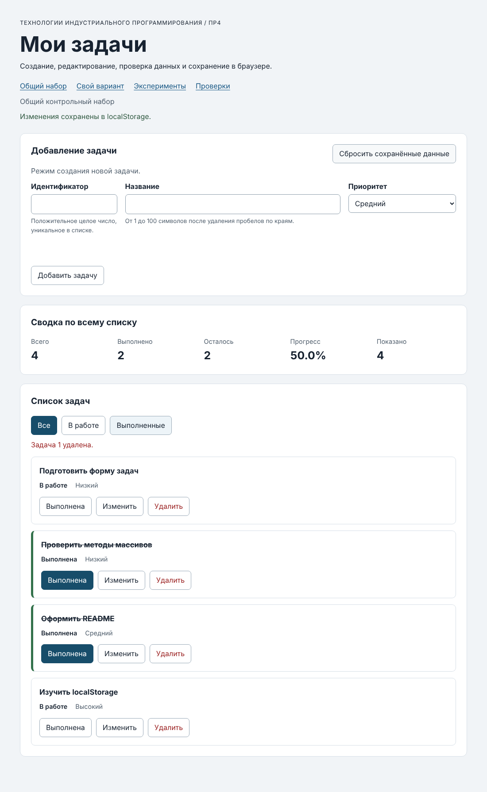
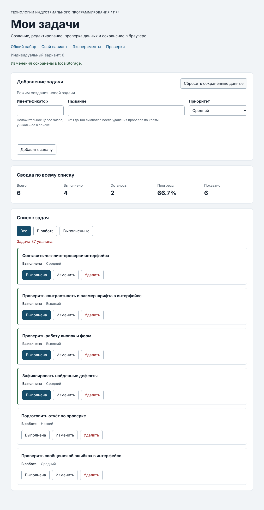

# Практическая работа № 4. Формы, валидация и локальное хранение данных

## Данные работы

| Поле | Значение |
|---|---|
| Имя | Чижова Виолетта |
| Группа | ЭФБО-13-25 |
| Вариант из ПР2–ПР3 | 6 («Проверка пользовательского интерфейса») |
| Node.js | v24.21.0 |
| Браузер | Google Chrome 155.0.8059.86 (официальная сборка, arm64) |
| Операционная система | macOS 26.2 (сборка 25C56) |

## Запуск

Рабочая папка: `practice-04` внутри личного репозитория.

```bash
npm test
npm start
```

Устанавливать зависимости через `npm install` не требуется.

```text
http://127.0.0.1:5504/
http://127.0.0.1:5504/index.html?dataset=variant
http://127.0.0.1:5504/examples/forms-storage.html
http://127.0.0.1:5504/checks.html
```

Если порт 5504 занят, запускается `node tools/serve.mjs 5505`, и во всех адресах используется `5505`.

## Перенос результата ПР3

Из ПР3 перенесены модули данных, сервиса, выборок и отображения. Регрессионные проверки сервиса после переноса: `npm run check:service` — **35 из 35**, ошибок нет. Исправлений в перенесённой логике не потребовалось.

| Файл | Что перенесено или изменено |
|---|---|
| `data.js` | Перенесён без изменений: `demoTasks`, `variantNumber = 6`, `variantTasks` (id 11, 23, 37, 41, 58, 64). |
| `task-service.js` | Перенесён из ПР3 (девять функций ПР2). Добавлена `updateTask(tasks, id, title, priority)`: меняет только `title` и `priority`, сохраняет `id`, `completed` и порядок, не изменяет входной массив. |
| `task-selectors.js` | Перенесён без изменений (`getVisibleTasks`). |
| `task-view.js` | Перенесён из ПР3. В карточку добавлена кнопка `data-action="edit"` («Изменить») между «Выполнена» и «Удалить»; остальная структура карточки и `textContent` сохранены. |

Новые модули ПР4: `form-validation.js` (`validateTaskDraft`), `task-storage.js` (`isValidTaskList`, `loadTasks`, `saveTasks`, `removeSavedTasks`). В `main.js` реализованы `renderApp`, `setFormMode`, `handleFormSubmit`, делегированный `handleTaskListClick` (с действием `edit`), `handleFilterClick`, `handleResetClick`. Дополнительно в готовую функцию `persistCurrentTasks` добавлен `try/catch` вокруг обращения к `window.localStorage` (см. собственную проверку 6).

## Эксперименты с формой и хранилищем

Страница `examples/forms-storage.html`. Прогнозы записаны до запуска, результаты прочитаны из журнала и из `validity` поля.

| № | До запуска: прогноз | После запуска: результат | Объяснение |
|---|---|---|---|
| 1. Пустое обязательное поле | Браузер заблокирует отправку: событие `submit` не возникнет, журнал не изменится, `validity.valid` будет `false` | Журнал остался «Действия ещё не выполнялись.». `validity.valid = false`, `valueMissing = true`, `customError = false`. Стандартное сообщение браузера (`validationMessage`): «Please fill out this field.» (язык текста зависит от языка браузера) | Атрибут `required` — нативное ограничение: невалидную форму браузер не отправляет, обработчик `submit` не вызывается. Отсутствие записи в журнале не является поломкой. |
| 2. Название из пробелов | `required` пропустит значение (три пробела — непустая строка), `submit` сработает, нужна прикладная проверка с `trim()` и `setCustomValidity` | Журнал: «submit получен, но прикладная проверка отклонила значение.». `valueMissing = false`, `customError = true`, `validationMessage` = «Название не должно состоять только из пробелов.»; сообщение показано и под полем | HTML проверяет только наличие символов, а не смысл значения. Прикладное правило «после `trim()` не пусто» выполняется в коде; `setCustomValidity` делает поле невалидным до следующего ввода. |
| 3. Типы значений `FormData` | `defaultPrevented = true`, название из `FormData` — строка, значение из `localStorage` — строка, название без пробелов по краям | В журнале: `submit.defaultPrevented: true`, `typeof FormData title: string`, `typeof localStorage value: string`, сохранено `{"title":"Тест","priority":"high"}` (введено `  Тест  `) | `FormData` всегда даёт строки; `preventDefault()` отменяет перезагрузку страницы; `localStorage` хранит только строки, поэтому объект сериализуется через `JSON.stringify`; `trim()` нормализует название. |
| 4. Строка в `localStorage` и JSON | `getItem` вернёт строку JSON, `JSON.parse` восстановит объект с теми же полями | Журнал: `raw` — строка `{"title":"Тест","priority":"high"}`, `parsed` — объект с `title: "Тест"` и `priority: "high"` | Тип результата `getItem` — строка (или `null`, если ключа нет). Объект получается только после `JSON.parse`. |
| 5. Повреждённый JSON | `JSON.parse` выбросит `SyntaxError`, поэтому нужен `try/catch` | После записи `{broken-json` чтение дало: «JSON.parse завершился ошибкой: Expected property name or '}' in JSON at position 1 (line 1 column 2)» | Исключение возникает при разборе строки, а не при записи. Без `try/catch` приложение не запустится, поэтому `loadTasks` перехватывает ошибку и возвращает исходный набор. |

## Организация кода

- **`task-service.js`** — чистые функции над массивом задач (добавление, изменение, удаление, `updateTask`). Не обращаются к DOM и хранилищу, не изменяют входные данные, ожидаемые ошибки возвращают как `{ ok: false, error }`.
- **`form-validation.js`** — чистая проверка черновика формы `validateTaskDraft(draft, tasks, editingId)`. Принимает строки из `FormData`, нормализует `id` и название, возвращает `{ ok, value }` либо `{ ok: false, errors }` по полям. DOM и сообщения не трогает.
- **`task-storage.js`** — чтение, запись и удаление сохранённых задач. Каждая функция получает объект `storage` аргументом, поэтому её можно проверить в Node.js на подставном объекте, без браузера, и подменить при сбое. Данные из JSON проверяются до использования (`isValidTaskList`): `JSON.parse` подтверждает только корректный синтаксис, а не структуру, и чужое или повреждённое значение не должно попасть в приложение.
- **`task-view.js`** — построение DOM карточек, сводки и сообщения о пустом списке через `textContent`.
- **`main.js`** — состояние (`currentTasks`, `currentFilter`, `editingId`), режимы формы, обработчики событий, вызов сервиса, валидации и хранилища, `persistCurrentTasks` и вывод статуса хранилища.

Поток данных: поле формы → `FormData` → `validateTaskDraft` → `addTask` или `updateTask` → новый массив в `currentTasks` → `saveTasks` → `renderApp`. Фильтр хранится отдельно от задач и не записывается; `renderApp` не обращается к `localStorage`.

## Проверка формы

Сценарии выполнены реальными кликами по форме приложения (общий набор после сброса).

| Сценарий | Ожидаемый результат | Фактический результат | Итог |
|---|---|---|---|
| Добавление корректной задачи | Задача добавлена, данные сохранены, форма очищена | `id 20` добавлен: `[1, 4, 7, 10, 20]`; всего 5, выполнено 2, осталось 3, прогресс 40.0%; ключ есть, id в нём: `[1, 4, 7, 10, 20]` | Пройдено |
| Повторяющийся id | Отказ без изменения списка | Ошибка у поля id: «Задача с идентификатором 4 уже существует.»; список и ключ не изменились (id в ключе `[1, 4, 7, 10, 20]`) | Пройдено |
| Пустое название | Отказ | Нативный `required` блокирует отправку (форма не отправляется), список не меняется | Пройдено |
| Название из пробелов | Отказ прикладной проверки | Ошибка у названия: «Название не должно быть пустым.»; список и ключ без изменений | Пройдено |
| Название длиной 100 | Успех | Задача `id 31` с названием из 100 символов добавлена и сохранена (длина в карточке 100) | Пройдено |
| Название длиной 101 | Отказ | При программно заданных 101 символах (в обход `maxlength`) ошибка: «Название не должно быть длиннее 100 символов.»; список не изменился. При обычном вводе браузер обрезает значение до 100 символов по `maxlength` | Пройдено |
| Редактирование title и priority | Меняется одна задача, статус сохраняется | `id 4`: название «Подготовить форму задач», приоритет «Низкий», статус «В работе» (`completed: false`) | Пройдено |
| Отмена редактирования | Возврат к пустой форме создания | После отмены: заголовок «Добавление задачи», кнопка «Добавить задачу», поле id доступно, фокус на поле id | Пройдено |

## Общий сценарий

Последовательность из раздела 6.8 методички, пройдена реальными кликами после нажатия «Сбросить сохранённые данные». Ожидания: шаг 0 — `[1, 4, 7, 10]`, 4 · 2 · 2 · `50.0%`; шаг 1 — 5 · 2 · 3 · `40.0%`; шаги 2–3 без изменения количеств; шаг 4 — 5 · 3 · 2 · `60.0%`; шаги 5–6 — `[4, 7, 10, 20]`, 4 · 2 · 2 · `50.0%`; шаг 7 — исходный набор. Фактические значения совпали с ожиданиями на каждом шаге.

| Шаг | Действие | Видимые id | Всего | Выполнено | Осталось | Прогресс | Состояние storage |
|---:|---|---|---:|---:|---:|---:|---|
| 0 | Сброс, исходный набор | `[1, 4, 7, 10]` | 4 | 2 | 2 | 50.0% | ключ отсутствует; «Сохранённые данные удалены, восстановлен исходный набор.» |
| 1 | Добавить 20 «Изучить localStorage», high | `[1, 4, 7, 10, 20]` | 5 | 2 | 3 | 40.0% | ключ есть, id в нём: `[1, 4, 7, 10, 20]` |
| 2 | Добавить повторный id 4 (отказ) | `[1, 4, 7, 10, 20]` | 5 | 2 | 3 | 40.0% | ключ есть, id в нём: `[1, 4, 7, 10, 20]`; ошибка у id: «Задача с идентификатором 4 уже существует.» |
| 3 | Изменить id 4: «Подготовить форму задач», low | `[1, 4, 7, 10, 20]` | 5 | 2 | 3 | 40.0% | ключ есть, id в нём: `[1, 4, 7, 10, 20]`; у id 4 `completed: false`, название «Подготовить форму задач», приоритет «Низкий» |
| 4 | Отметить выполненной id 7 | `[1, 4, 7, 10, 20]` | 5 | 3 | 2 | 60.0% | ключ есть, id в нём: `[1, 4, 7, 10, 20]` |
| 5 | Удалить id 1 | `[4, 7, 10, 20]` | 4 | 2 | 2 | 50.0% | ключ есть, id в нём: `[4, 7, 10, 20]` |
| 6 | Перезагрузка | `[4, 7, 10, 20]` | 4 | 2 | 2 | 50.0% | ключ есть, id в нём: `[4, 7, 10, 20]`; строка состояния: «Данные восстановлены из localStorage.» |
| 7 | Сброс данных | `[1, 4, 7, 10]` | 4 | 2 | 2 | 50.0% | ключ отсутствует; «Сохранённые данные удалены, восстановлен исходный набор.» |

Дополнительно (повреждённый JSON): в ключ `tip-js-practice-04:demo` записана строка `{broken-json`, страница обновлена. Приложение запустилось с исходным набором ``[1, 4, 7, 10]``, строка состояния показала предупреждение: «Сохранённые данные повреждены (некорректный JSON: Expected property name or '}' in JSON at position 1 (line 1 column 2)). Используется исходный набор.». После сброса ключ отсутствует.



## Проверка восстановления и ошибок

| Случай | Ожидание | Фактический результат | Итог |
|---|---|---|---|
| Записи нет | Используется независимая копия исходного набора | После сброса и при первом запуске показан набор ``[1, 4, 7, 10]``, ключ отсутствует, статус: «Сохранённые данные удалены, восстановлен исходный набор.». Изменения копии не меняют `demoTasks` (проверка 27 в `modules.checks.js`) | Пройдено |
| Корректная запись | Данные восстанавливаются после перезагрузки | После перезагрузки (шаг 6) ``[4, 7, 10, 20]``, статус «Данные восстановлены из localStorage.» | Пройдено |
| Повреждённый JSON | Приложение запускается с исходным набором и предупреждением | Исходный набор, предупреждение: «Сохранённые данные повреждены (некорректный JSON: Expected property name or '}' in JSON at position 1 (line 1 column 2)). Используется исходный набор.» | Пройдено |
| Неверная версия или схема | Исходный набор и предупреждение | Версия 2: «Неизвестная версия сохранённых данных. Используется исходный набор.». Схема `[{"id":1}]`: «Сохранённые данные не соответствуют схеме. Используется исходный набор.». Повторяющиеся id: «Сохранённые данные не соответствуют схеме. Используется исходный набор.». Во всех случаях показан набор ``[1, 4, 7, 10]`` | Пройдено |
| Сброс | Удаляется только ключ текущего набора | Ключ текущего набора удалён (`keyPresent = false`); ключ общего набора при сбросе варианта не затрагивается (набор `[1, 4, 7, 10]` не изменился) | Пройдено |
| Общий и индивидуальный наборы | Изменения не смешиваются | Изменения варианта (id 75, 23, 37) не повлияли на общий набор: ``[1, 4, 7, 10]``, 4 · 2 · 2 · `50.0%`, ключ общего набора отсутствует | Пройдено |

## Индивидуальный вариант

Вариант 6, тема «Проверка пользовательского интерфейса». Исходные задачи (`id`): 11, 23, 37, 41, 58, 64; выполнены первые пять. Страница `?dataset=variant`, подпись: «Индивидуальный вариант: 6». Выполнено после сброса: добавлена `id = 75` («Проверить сообщения об ошибках в интерфейсе», приоритет «Средний», статус «В работе»), отредактирована `id = 23` (новое название «Проверить контрастность и размер шрифта в интерфейсе», приоритет «Высокий», статус «Выполнена» сохранён), удалена `id = 37`, страница перезагружена.

Ожидание по методичке: выполнено после добавления и удаления — 4, итоговый прогресс при шести задачах — `66.7%`. Фактический результат совпал.

| Этап | Всего | Выполнено | Осталось | Прогресс | Видимые id |
|---|---:|---:|---:|---:|---|
| Исходный набор (после сброса) | 6 | 5 | 1 | 83.3% | `[11, 23, 37, 41, 58, 64]` |
| После добавления `75` | 7 | 5 | 2 | 71.4% | `[11, 23, 37, 41, 58, 64, 75]` |
| После редактирования `23` | 7 | 5 | 2 | 71.4% | `[11, 23, 37, 41, 58, 64, 75]` |
| После удаления `37` | 6 | 4 | 2 | 66.7% | `[11, 23, 41, 58, 64, 75]` |
| После перезагрузки | 6 | 4 | 2 | 66.7% | `[11, 23, 41, 58, 64, 75]` |
| После сброса | 6 | 5 | 1 | 83.3% | `[11, 23, 37, 41, 58, 64]` |

Общий набор после работы с вариантом не изменился (``[1, 4, 7, 10]``). В реализации нет ветвления по номеру варианта: различаются только исходные данные и ключ хранилища (`tip-js-practice-04:variant`).



## Протокол проверок сервиса

`npm run check:service`:

```text
OK: 01. Создание задачи с явным приоритетом
OK: 02. Приоритет по умолчанию
OK: 03. Удаление краевых пробелов без изменения внутренних
OK: 04. Граничные длины названия и положительный безопасный id
OK: 05. Некорректные названия при создании
OK: 06. Некорректные идентификаторы при создании
OK: 07. Все допустимые приоритеты и отклонение недопустимых
OK: 08. Каждый вызов createTask возвращает новый объект
OK: 09. Поиск по id, а не по индексу
OK: 10. Отсутствующая задача и пустой массив при поиске
OK: 11. Поиск не преобразует строковый id в число
OK: 12. Получение невыполненных задач
OK: 13. Пустой список, все выполнены и все не выполнены
OK: 14. Названия в исходном порядке и пустой список
OK: 15. Сводка по общему набору
OK: 16. Сводка по пустому списку
OK: 17. Сводка: ничего не выполнено и выполнено всё
OK: 18. Процент остаётся числом без предварительного округления
OK: 19. Добавление в конец без изменения входного массива
OK: 20. Добавление в пустой список с приоритетом по умолчанию
OK: 21. Повторяющийся id отклоняется
OK: 22. Добавление не обходит проверки createTask
OK: 23. Изменение completed в обе стороны
OK: 24. completed принимает только boolean
OK: 25. Некорректный или отсутствующий id при изменении статуса
OK: 26. Повторная установка статуса создаёт новый результат
OK: 27. Переименование сохраняет остальные поля
OK: 28. Проверки названия при переименовании
OK: 29. Некорректный или отсутствующий id при переименовании
OK: 30. Удаление по id с сохранением порядка
OK: 31. Удаление единственной записи
OK: 32. Некорректный, отсутствующий id и удаление из пустого списка
OK: 33. Входные объекты не изменяются ни одной операцией
OK: 34. Общий сценарий и все промежуточные сводки
OK: 35. Работа с другим набором, без зависимости от demoTasks
Проверок пройдено: 35; не пройдено: 0.
```

## Протокол проверок новых модулей

`npm run check:modules`:

```text
OK: 01. updateTask изменяет название и приоритет выбранной задачи
OK: 02. updateTask нормализует название и сохраняет completed
OK: 03. updateTask не изменяет входной массив и объекты
OK: 04. updateTask отклоняет некорректный и отсутствующий id
OK: 05. updateTask отклоняет некорректные название и приоритет
OK: 06. Валидация создания нормализует поля
OK: 07. Валидация отклоняет некорректные id
OK: 08. Валидация отклоняет повторяющийся id при создании
OK: 09. Валидация проверяет название после trim
OK: 10. Валидация принимает только три приоритета
OK: 11. В режиме редактирования используется editingId
OK: 12. Редактирование отсутствующей задачи отклоняется
OK: 13. Валидация не изменяет draft и список
OK: 14. Проверка схемы принимает корректный список
OK: 15. Проверка схемы отклоняет неверную структуру
OK: 16. Отсутствующая запись возвращает независимую копию исходных данных
OK: 17. Корректная запись восстанавливается из хранилища
OK: 18. Повреждённый JSON приводит к безопасному fallback
OK: 19. Неизвестная версия приводит к безопасному fallback
OK: 20. Некорректные задачи из JSON не принимаются
OK: 21. Ошибка getItem перехватывается
OK: 22. Сохранение записывает версию и задачи
OK: 23. Некорректный список не записывается
OK: 24. Ошибка setItem перехватывается
OK: 25. Удаляется только переданный ключ
OK: 26. Ошибка removeItem перехватывается
OK: 27. Результат загрузки не разделяет объекты с fallback
Проверок пройдено: 27; не пройдено: 0.
```

## Протокол браузерных проверок

Текстовый протокол со страницы `http://127.0.0.1:5504/checks.html` (ошибок в Console нет):

```text
OK: Фильтры ПР3 сохраняют порядок и не изменяют вход
OK: Карточка содержит toggle, edit и delete
OK: Название задачи выводится как текст
OK: Повторная отрисовка списка не накапливает карточки
OK: Сводка использует полный список и отдельный visibleCount
OK: Пустые состояния различают список и фильтр
OK: Приложение запускается с исходным набором
OK: Корректная форма добавляет задачу и сохраняет данные
OK: Повторяющийся id отклоняется без записи
OK: Название из пробелов отклоняется прикладной проверкой
OK: Нативные ограничения не пропускают пустую форму
OK: Кнопка edit заполняет форму и блокирует id
OK: Редактирование меняет title и priority, сохраняя completed
OK: Отмена редактирования возвращает режим создания
OK: Успешная отправка очищает ошибки и форму
OK: Изменение статуса сохраняется
OK: Удаление сохраняется
OK: Фильтр не записывается, но сохраняется после изменения данных
OK: Перезагрузка восстанавливает сохранённые задачи
OK: Сброс удаляет ключ и восстанавливает исходный набор
OK: Повреждённый JSON не ломает запуск
OK: Некорректная схема из storage заменяется исходным набором
OK: Общий и индивидуальный наборы используют разные ключи
Всего: 23. Пройдено: 23. Ошибок: 0.
```

## Собственные проверки

Ожидания сформулированы по правилам методички до запуска, фактические значения прочитаны из DOM и из `localStorage`. Формат: видимые id; всего / выполнено / осталось / прогресс.

| № | Исходное состояние и действия | Ожидаемый результат | Фактический результат | Итог |
|---:|---|---|---|---|
| 1. Граница формы | Общий набор после сброса. Добавить `id 31` с названием из 100 символов; ввести 101 символ в `id 32`; задать 101 символ программно (в обход `maxlength`) для `id 34`; `id 33` с названием из трёх пробелов | 100 символов — успех. 101 при обычном вводе: браузер обрезает значение до 100. 101 программно: отказ с ошибкой у названия. Пробелы: отказ «не должно быть пустым» (нативный `required` пробелы пропускает) | `id 31` добавлен (длина 100). Ввод 101 символа дал `id 32` с названием из 100 символов (обрезано браузером). Программно заданные 101 символ (`validity.tooLong = false`): ошибка «Название не должно быть длиннее 100 символов.», ключ без `34`. Пробелы: «Название не должно быть пустым.». Итоговый список: ``[1, 4, 7, 10, 31, 32]`` | Пройдено |
| 2. Восстановление после перезагрузки | Сброс. Добавить `id 41` («Проверка восстановления», low), выполнить `id 4`, выбрать фильтр «Выполненные», перезагрузить страницу | До перезагрузки видимы ``[1, 4, 10]``, всего 5, выполнено 3, `60.0%`. После: все задачи из хранилища ``[1, 4, 7, 10, 41]``, фильтр сброшен на «Все» (фильтр не сохраняется), статус «Данные восстановлены из localStorage.», выполнено 3, `60.0%` | До: ``[1, 4, 10]``, 5 / 3 / 2 / 60.0%, фильтр «completed». После: ``[1, 4, 7, 10, 41]``, 5 / 3 / 2 / 60.0%, фильтр «all», статус «Данные восстановлены из localStorage.» | Пройдено |
| 3. Повреждённая структура в storage | Записать в ключ: версию 2; JSON с задачей `{"id":1}`; JSON с двумя задачами с одним `id`; перезагружать после каждой записи | Во всех трёх случаях исходный набор `[1, 4, 7, 10]` и предупреждение; не использовать частично | Версия 2: «Неизвестная версия сохранённых данных. Используется исходный набор.». Структура: «Сохранённые данные не соответствуют схеме. Используется исходный набор.». Дубли id: «Сохранённые данные не соответствуют схеме. Используется исходный набор.». Везде ``[1, 4, 7, 10]``, предупреждение включено | Пройдено |
| 4. Сбой записи (квота) | Сброс. Подменить `setItem` так, чтобы он выбрасывал `QuotaExceededError`; добавить `id 51`; перезагрузить | Задача появляется в списке, но не сохраняется; пользователь видит предупреждение; после перезагрузки задачи нет | Список: ``[1, 4, 7, 10, 51]``, ключ в хранилище отсутствует. Статус: «Не удалось записать в localStorage: The quota has been exceeded.. После перезагрузки изменения могут быть потеряны.». После перезагрузки: ``[1, 4, 7, 10]``, «Используется исходный набор; сохранённых данных пока нет.» | Пройдено |
| 5. Исключение при чтении (хранилище запрещено) | `window.localStorage` выбрасывает `SecurityError`; открыть страницу | Приложение запускается с исходным набором и предупреждением | `[1, 4, 7, 10]`, всего 4, статус: «Хранилище не инициализировано: Access is denied for this document.» | Пройдено |
| 6. Исключение при записи (хранилище запрещено) | То же состояние; добавить `id 61` | Действие не ломается: задача появляется, предупреждение объясняет, что изменения не сохранены | `[1, 4, 7, 10, 61]`, всего 5; сообщение: «Задача 61 добавлена. Хранилище недоступно: Access is denied for this document..» | Пройдено |

Проверка 6 выявила пробел в готовой функции `persistCurrentTasks`: обращение к `window.localStorage` стояло вне `try/catch`, и при запрете хранилища обработчик действия бы аварийно завершился. Доступ обёрнут в `try/catch`, после чего браузерные проверки и сценарий проходят.

## Отладка и клавиатура

**Остановка в `handleFormSubmit`.** Точки останова поставлены в `src/main.js`: строка 216 (вызов `persistCurrentTasks` после успешной проверки) и строка 198 (вызов `showFormErrors` при отказе). Значения получены отладчиком браузера в момент остановки.

| Что смотрели | Значение |
|---|---|
| Сырой `draft` (успех) | `{"id":"88","title":"   Отладка формы   ","priority":"high"}`, `typeof draft.id` — `string`: поля — строки, название с пробелами по краям |
| Результат `validateTaskDraft` | `{"ok":true,"value":{"id":88,"title":"Отладка формы","priority":"high"}}`: `id` стал числом, название нормализовано |
| Результат сервисной операции | `result.ok = true`, последняя запись: `{"id":88,"title":"Отладка формы","completed":false,"priority":"high"}`, `wasEditing = false` |
| Записанная строка JSON | `{"version":1,"tasks":[{"id":1,"title":"Изучить функции","completed":true,"priority":"medium"},{"id":4,"title":"Подготовить модель задач","completed":false,"priority":"high"},{"id":7,"title":"Проверить методы массивов","completed":false,"priority":"low"},{"id":10,"title":"Оформить README","completed":true,"priority":"medium"},{"id":88,"title":"Отладка формы","completed":false,"priority":"high"}]}` |
| Ошибочный сценарий (повторный id) | `draft`: `{"id":"4","title":"Дубликат","priority":"medium"}`; `checked`: `{"ok":false,"errors":{"id":"Задача с идентификатором 4 уже существует."}}`; `editingId = null`. Вызов сервиса и запись в `localStorage` не выполняются: содержимое ключа после отказа не изменилось (true) |

**Клавиатура и фокус** (Tab, Enter, Space):
- После сброса фокус в поле id. Ввод `77`, Tab → название, ввод текста, Tab → приоритет, стрелка вниз меняет значение на «low», Tab → кнопка «Добавить задачу» (фокус: `form-submit`), Enter отправляет форму: задача `77` добавлена, ``[1, 4, 7, 10, 77]``.
- После успешной отправки фокус возвращается в поле id (`task-id`).
- Кнопка «Изменить» (Space) переводит форму в режим «Редактирование задачи 77», фокус в поле названия (`task-title`).
- Отмена редактирования (Enter на кнопке отмены): режим создания, фокус в поле id (`task-id`).
- «Выполнена» (Enter) на карточке 77: выполнено 3, прогресс 60.0%, фокус остаётся на кнопке этой же карточки (`data-action="toggle"`, карточка 77).

## Вид приложения

Скриншоты интерфейса после реальных действий приведены в разделах «Общий сценарий» и «Индивидуальный вариант».

## Дополнительное задание

Не выполнялось.

## Вывод

В ПР4 к списку задач из ПР3 добавлены форма создания и редактирования, чистая валидация и хранение в `localStorage`. Проверка ввода разделена на три уровня: нативные ограничения HTML (`required`, `maxlength`) блокируют отправку до события `submit`; прикладная валидация (`validateTaskDraft`) проверяет смысл значений (`trim`, длину, уникальность `id`, допустимый приоритет); проверка данных после чтения (`isValidTaskList`) нужна потому, что корректный синтаксис JSON не гарантирует нужную структуру, и повреждённая запись заменяется исходным набором с предупреждением. Функции хранения получают `storage` аргументом, поэтому их можно проверить без браузера и подменить при сбое записи или доступа. Самым показательным оказался случай запрета хранилища: без защиты доступа к `window.localStorage` обработчик действия падал бы целиком, а теперь пользователь видит понятное предупреждение.

## Самопроверка

- [x] `npm run check:service`: 35 из 35.
- [x] `npm run check:modules`: 27 из 27.
- [x] `checks.html`: «Всего: 23. Пройдено: 23. Ошибок: 0.»
- [x] Общий сценарий из 8 шагов и повреждённый JSON совпали с ожиданиями.
- [x] Индивидуальный сценарий варианта 6 выполнен (66.7%).
- [x] Шесть собственных проверок, включая границу формы, восстановление и сбой хранилища.
- [x] Отладка в `handleFormSubmit` и клавиатура описаны.
- [ ] Код отправлен в мой репозиторий.
