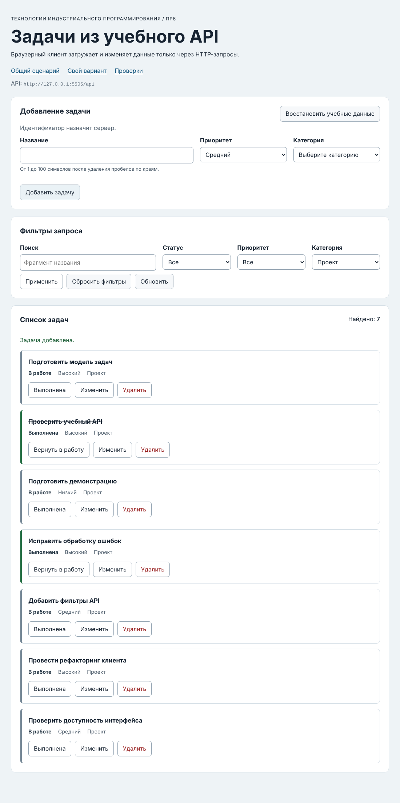
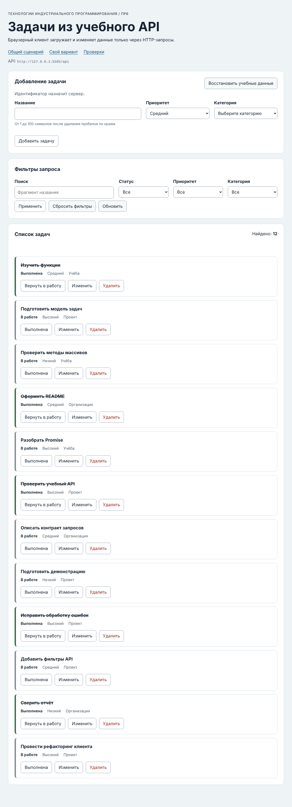

# Отчёт по практической работе № 6

**Тема:** Подключение браузерного приложения к API<br>
**Автор:** Чижова Виолетта<br>
**Группа:** ЭФБО-13-25<br>
**Вариант:** 6

## 1. Цель работы

Связать браузерный интерфейс списка задач с HTTP API и сделать состояние интерфейса предсказуемым во время асинхронных операций. Отработаны: запросы `GET`, `POST`, `PATCH` и `DELETE` через `fetch`, JSON-тело и ответы `200`, `201`, `204`; разделение общего HTTP-клиента, предметного API, контроллера и DOM-представления; состояния `loading`, `ready`, `empty`, `error`; клиентская проверка формы; повторная загрузка после изменения на сервере; отмена предыдущего запроса и защита от устаревшего ответа; безопасный вывод серверных данных через `textContent`.

Получено приложение, в котором категории и задачи приходят из учебного API, фильтры превращаются в серверные query-параметры, задача создаётся, редактируется, меняет статус и удаляется, а сервер остаётся единственным источником данных. Проходят 70 проверок Node.js (23 + 33 + 14) и 14 браузерных проверок.

## 2. Запуск

**Версии:**

```text
node --version: v24.21.0
npm --version:  11.19.0
```

**Команда запуска** (из папки `practice-06`):

```bash
npm start
```

**Адрес приложения:** `http://127.0.0.1:5506/`<br>
**Индивидуальный сценарий:** `http://127.0.0.1:5506/?dataset=variant`<br>
**Адрес API:** `http://127.0.0.1:5505/api`<br>
**Браузерные проверки:** `http://127.0.0.1:5506/checks.html`

Проверки Node.js: `npm test` (последовательно `check:api`, `check:modules`, `check:integration`). Зависимости устанавливать не нужно. Другие порты не использовались; для другого порта API приложение открывается с параметром `?api=http://127.0.0.1:ПОРТ/api`.

## 3. Реализация

Код разделён по ответственности: `api-client.js` (общий HTTP-клиент), `task-api.js` (операции над задачами), `form-validation.js` (проверка формы), `task-view.js` (карточки), `app-controller.js` (состояние и сценарии). Готовые `dom-app.js` и `main.js` не менялись; `api/server.mjs` не менялся.

### 3.1. HTTP-клиент

`createApiClient({ baseUrl, fetchFn, timeoutMs })` возвращает `requestJson(path, { method, query, body, signal, timeoutMs })`. Решение ПР5 перенесено и расширено:

- допустимы только `GET`, `POST`, `PATCH`, `DELETE`; метод приводится к верхнему регистру; другой метод или `body` у `GET` отклоняется `TypeError` до сетевого запроса;
- к каждому запросу добавляется `Accept: application/json`; при наличии `body` он сериализуется один раз через `JSON.stringify` и добавляется `Content-Type: application/json` (у запросов без тела этого заголовка нет);
- тайм-аут (`AbortSignal.timeout`) и внешний `AbortSignal` объединяются через `AbortSignal.any`; вид отказа определяется по состоянию сигналов: `aborted`, затем `timeout`, иначе `network`;
- порядок обработки ответа: сначала `response.ok` (HTTP-ошибка сохраняет `status`, `code`, `details`, `url`, вид `http`), затем статус `204` (возвращается `null`, JSON не читается), затем `Content-Type` и разбор JSON; ошибки формата дают `invalid-response`;
- `ApiError` из обработки ответа не попадает в блок `catch` для `fetch`, поэтому HTTP-ошибка не маскируется сетевой.

### 3.2. Доменный API

`createTaskApi(client)` возвращает девять операций: `getTasks(filters, { signal })`, `getTaskById`, `getCategories`, `loadInitialData` (параллельно, оба запроса начинаются до общего `await`), `createTask` (`POST /tasks`), `updateTask` и `setTaskCompleted` (`PATCH /tasks/:id`, у второго тело `{ completed }`), `deleteTask` (`DELETE /tasks/:id`, ожидается строго `null`, иначе `invalid-response`) и `resetDemoData` (`POST /debug/reset` без тела).

Схема проверяется на стороне клиента: каждая задача и категория проходят `isTask`/`isCategory`, коллекция проверяется на уникальность `id` и совпадение `meta.total` с длиной `data`, ответ сброса данных на форму `{ reset: true, total }`. Фильтры проверяются до запроса (неизвестный ключ или неверное значение дают `TypeError`). Смысл полей создаваемой задачи доменный слой намеренно не отклоняет: серверная ошибка `VALIDATION_ERROR` должна остаться доступной вызывающему коду (интеграционная проверка 09 убеждается в этом).

### 3.3. Состояния интерфейса

`loadCurrentTasks` в контроллере выполняет переходы: `loading` (список скрыт, `aria-busy=true`) → `ready` (есть задачи), `empty` (запрос успешен, но задач нет) или `error` (с сообщением из `messageForError` и кнопкой «Повторить загрузку»). `empty` относится к данным (сервер ответил пустым списком, повтор не нужен), `error` — к отказу получить данные (нужен повтор). Пока категории не получены, и первая загрузка, и повтор, и смена фильтров используют `loadInitialData`; после этого — `getTasks`. Отмена (`aborted`) пользователю не показывается.

### 3.4. Изменение данных

Все мутации идут через одну внутреннюю функцию `runMutation`: блокировка кнопок (`setMutationPending(true)`), запрос к API, сообщение об успехе, повторный `GET` с текущими фильтрами, при ошибке — сообщение через `messageForError`, в `finally` блокировка снимается. Создание отправляет нормализованные `title`, `priority`, `categoryId` (сервер назначает `id` и `completed`), редактирование отправляет `PATCH` с теми же тремя полями (статус не передаётся и сохраняется), переключение статуса вычисляет значение от актуальной задачи в данных, а не от текста кнопки. Список после мутации не правится локально, а перезапрашивается: источник истины остаётся сервер. Повторная отправка при уже выполняемой мутации игнорируется.

### 3.5. Защита от устаревшего ответа

Двойная защита: (1) перед новой загрузкой предыдущая отменяется через `AbortController`; (2) у каждой загрузки есть номер (`lastLoadId`), и после `await` результат применяется, только если номер совпадает с последним. Одного `AbortController` недостаточно: отмена зависит от того, что нижний слой реально прервёт операцию, а ответ уже мог прийти в очередь микрозадач; проверка номера исключает применение старых данных в любом случае (модульная проверка 27 это показывает: ответ первой загрузки приходит уже после отмены и игнорируется). `destroy()` отменяет активную загрузку и увеличивает номер.

## 4. Индивидуальный вариант

**Начальный фильтр:** `categoryId=2` (категория «Проект»).<br>
**Индивидуальный сценарий:** создать задачу категории «Проект»; карточка появляется в выборке.

| Шаг | Ожидание | Фактический результат |
|---|---|---|
| Открыть `/?dataset=variant` | Запрос `GET /api/tasks?categoryId=2`, в фильтре выбрана «Проект», видны 6 задач | `GET /api/tasks?categoryId=2 → 200`; `GET /api/categories → 200`. Фильтр категории: значение `2`. Видимые id: `[4, 16, 22, 25, 28, 34]`, «Найдено: 6», состояние `ready` |
| Создать задачу: название «Проверить доступность интерфейса», приоритет «Средний», категория «Проект» | `POST /api/tasks` с телом без `id` и `completed`, ответ `201` и `Location`, затем повторный `GET` с тем же фильтром; новая карточка в выборке, итог 7 | `POST /api/tasks → 201`; `GET /api/tasks?categoryId=2 → 200`. Тело `POST`: `{"title":"Проверить доступность интерфейса","priority":"medium","categoryId":2}`, `Location: /api/tasks/35`. Видимые id: `[4, 16, 22, 25, 28, 34, 35]`, «Найдено: 7», карточка 35: «Проверить доступность интерфейса», Средний, Проект, `completed: false`, сообщение «Задача добавлена.» |
| Дополнительно: создать задачу категории «Учёба» при том же фильтре | Задача сохраняется на сервере, но в текущую выборку не попадает | `POST` → 201, повторный `GET` с `categoryId=2`; видимые id без изменений (`[4, 16, 22, 25, 28, 34, 35]`), итог 7; на сервере задача 36: `categoryId = 1` |



## 5. Результаты проверок

### 5.1. Автоматизированные проверки Node.js

```text
Итог API: успешно 23, ошибок 0.
Итог модулей: успешно 33, ошибок 0.
Итог интеграции: успешно 14, ошибок 0.
```

Всего 70 проверок (23 + 33 + 14). Полные протоколы:

`npm run check:api`

```text
OK: 01. health возвращает JSON и заголовки CORS
OK: 02. исходный список содержит 12 задач в контрольном порядке
OK: 03. фильтры и поиск применяются совместно
OK: 04. неверный или повторяющийся query даёт 400
OK: 05. POST создаёт задачу, обрезает title и назначает id
OK: 06. созданная задача доступна по id и в списке
OK: 07. POST требует application/json
OK: 08. повреждённый JSON даёт структурированную ошибку
OK: 09. серверная валидация сообщает ошибки полей
OK: 10. PATCH изменяет только переданные поля
OK: 11. PATCH изменяет completed логическим значением
OK: 12. пустой PATCH и неизвестное поле отклоняются
OK: 13. DELETE возвращает 204 без тела
OK: 14. отсутствующая задача даёт 404 для PATCH и DELETE
OK: 15. неверный id даёт 400
OK: 16. категории доступны отдельным ресурсом
OK: 17. HEAD возвращает заголовки без тела
OK: 18. OPTIONS объявляет CORS для изменяющих методов
OK: 19. неподдерживаемый метод даёт 405 и Allow
OK: 20. отладочные маршруты воспроизводят виды ошибок
OK: 21. слишком большое тело запроса отклоняется
OK: 22. reset восстанавливает данные и счётчик id
OK: 23. два экземпляра API не делят изменяемое состояние
Итог API: успешно 23, ошибок 0.
```

`npm run check:modules`

```text
OK: 01. buildUrl соединяет baseUrl, путь и кодированный query
OK: 02. buildUrl не изменяет объект query
OK: 03. createApiClient проверяет конфигурацию
OK: 04. GET отправляет Accept, query и AbortSignal
OK: 05. POST сериализует тело и добавляет Content-Type
OK: 06. PATCH поддерживается, а неизвестный метод и body у GET отклоняются
OK: 07. успешный 204 преобразуется в null
OK: 08. JSON-ошибка HTTP сохраняет поля контракта
OK: 09. HTTP-ошибка важнее неверного Content-Type
OK: 10. неверный Content-Type и повреждённый JSON отклоняются
OK: 11. сетевая ошибка сохраняется как cause
OK: 12. тайм-аут отличается от внешней отмены
OK: 13. createTaskApi требует requestJson
OK: 14. getTasks нормализует фильтры и проверяет ответ
OK: 15. getTasks отклоняет неверные фильтры до запроса
OK: 16. loadInitialData параллельно запрашивает задачи и категории
OK: 17. createTask отправляет POST и проверяет задачу
OK: 18. update и смена статуса отправляют PATCH
OK: 19. deleteTask требует ответ 204, reset проверяет подтверждение
OK: 20. доменный API отклоняет неверную схему ответа
OK: 21. validateTaskDraft нормализует корректные данные
OK: 22. validateTaskDraft возвращает ошибки каждого поля
OK: 23. контроллер проверяет зависимости
OK: 24. start отображает loading, категории, задачи и ready
OK: 25. пустой ответ отображает состояние empty
OK: 26. ошибка загрузки отображается, а aborted не показывается
OK: 27. новая загрузка отменяет предыдущую и игнорирует устаревший ответ
OK: 28. невалидная форма не вызывает API
OK: 29. создание блокирует действия, очищает форму и обновляет список
OK: 30. редактирование, toggle и delete используют id текущей задачи
OK: 31. ошибка мутации показывается и снимает блокировку
OK: 32. reset вызывает сервер и перезагружает текущий фильтр
OK: 33. messageForError не раскрывает внутреннюю ошибку
Итог модулей: успешно 33, ошибок 0.
```

`npm run check:integration`

```text
OK: 01. начальная загрузка получает задачи и категории
OK: 02. клиент создаёт задачу и получает назначенный id
OK: 03. созданная задача читается по id
OK: 04. редактирование сохраняется на сервере
OK: 05. созданная задача находится серверным поиском
OK: 06. смена статуса видна через фильтр
OK: 07. DELETE удаляет запись и возвращает null
OK: 08. повторное удаление сохраняет код и детали 404
OK: 09. серверная ошибка валидации доступна клиенту
OK: 10. 204 не вызывает ошибку разбора JSON
OK: 11. реальная задержка прерывается по тайм-ауту
OK: 12. внешний AbortController отменяет реальный запрос
OK: 13. повреждённый JSON и text/plain определяются как invalid-response
OK: 14. reset восстанавливает исходный набор
Итог интеграции: успешно 14, ошибок 0.
```

### 5.2. Браузерные проверки

```text
Всего: 14. Пройдено: 14. Ошибок: 0.
```

Протокол со страницы `http://127.0.0.1:5506/checks.html` (в Console только ожидаемые сообщения от самих проверок: ответ 404 после удаления задачи и отказ соединения с недоступным портом):

```text
OK: Карточка содержит безопасный текст и три действия
OK: Повторная отрисовка списка не накапливает карточки
OK: Начальная загрузка показывает 12 задач и 3 категории
OK: Фильтры формируют новый серверный запрос
OK: Поиск без результатов показывает empty, а сброс возвращает список
OK: Корректная форма создаёт задачу с серверным id
OK: Ошибки формы не отправляют запрос и связаны с полями
OK: Редактирование заполняет форму и сохраняет изменения
OK: Отмена редактирования возвращает режим создания
OK: Смена статуса подтверждается сервером
OK: Удаление подтверждается и сохраняется на сервере
OK: Сброс восстанавливает учебный набор
OK: Недоступный API показывает error и кнопку повтора
OK: Приложение не использует localStorage как источник данных
Всего: 14. Пройдено: 14. Ошибок: 0.
```

**Найденный дефект готовой проверки.** При первом запуске пройдено 13 из 14: упала проверка «Корректная форма создаёт задачу с серверным id» с сообщением `Не найден элемент: [data-task-id="35"]`. Причина в самой проверке, а не в приложении: строка `waitFor(() => requireNode(doc, '[data-task-id="35"]'), …)` вызывает `requireNode`, который при отсутствии элемента выбрасывает исключение, а `waitFor` не перехватывает его и падает на первом опросе, когда ответ сервера ещё не получен. Так упала бы любая корректная реализация без оптимистичного обновления. Проверено отдельно: сразу после `requestSubmit()` карточка 35 отсутствует (синхронный поиск вернул `false`), а через мгновение появляется с названием «Подключить браузер», итог становится 13, поле названия очищается. В `checks/browser.checks.js` изменена одна строка: `requireNode(doc, …)` заменён на `doc.querySelector(…)`, который возвращает `null` и позволяет `waitFor` ждать. После исправления пройдены 14 из 14. Проверка не ослаблена: следующая строка по-прежнему проверяет текст карточки и итог.

### 5.3. Ручные проверки

Выполнены реальными действиями в браузере; для каждого сценария записаны запросы (сетевой журнал) и состояние интерфейса.

| Сценарий | Ожидаемый результат | Фактический результат |
|---|---|---|
| 1. API не запущен (адрес `:5599`, сервера нет) | Состояние `error`, кнопка повтора | `error`; сообщение «Нет соединения с учебным API. Проверьте, запущен ли npm start.»; кнопка «Повторить загрузку» видна; запросы: `GET /api/tasks`, `GET /api/categories` → `failed: ERR_CONNECTION_REFUSED`; в форме только пункт «Выберите категорию» (1). Приложение не упало |
| 2. Запуск API и «Повторить загрузку» | Повторяется начальная загрузка, категории появляются | После запуска API на том же порту и нажатия кнопки: `GET /api/tasks → 200`; `GET /api/categories → 200`; состояние `ready`, видимых задач 12, «Найдено: 12», вариантов категории в форме 4, кнопка повтора скрыта. Сработал `loadInitialData`, а не `getTasks` |
| 3. Пустая выборка | Состояние `empty`, список без старых карточек | Поиск «такой задачи точно нет»: `GET /api/tasks?q=… → 200`; состояние `empty`, сообщение «По выбранным условиям задач нет.», «Найдено: 0», список скрыт, карточек нет. «Сбросить фильтры» вернул 12 задач (`GET /api/tasks`) |
| 4. Ошибка формы | Запрос не отправляется, поля получают сообщения | Пустое название (пробелы) и категория не выбрана: в сетевом журнале запросов нет; сообщения: название — «Введите название задачи.», категория — «Выберите категорию.»; `aria-invalid` у полей: task-title, task-category; список не изменился (12 задач). После исправления: `POST /api/tasks → 201`; `GET /api/tasks → 200`, ошибки очищены, `aria-invalid` снят |
| 5. Создание и обновление страницы | Созданная задача остаётся на сервере | Создание: `POST /api/tasks → 201`; `GET /api/tasks → 200` (`Location: /api/tasks/35`), итог 13. После перезагрузки страницы задача 35 «Задача после обновления» на месте, итог 13; `localStorage` и `sessionStorage` пусты (длина 0 и 0) |
| 6. Редактирование с сохранением `completed` | Статус не меняется | Задача 4 переведена в «Выполнена», затем изменены название и приоритет. `PATCH` с телом `{"title":"Подготовить модель задач (правка)","priority":"low","categoryId":2}` (поле `completed` не передаётся). После обновления: «Подготовить модель задач (правка)», приоритет «Низкий», `completed: true`; на сервере `completed: true` |
| 7. Смена статуса при активном фильтре | Задача исчезает из выборки после повторного GET | Фильтр «Статус: В работе», 7 задач. Выполнена задача 4: `PATCH /api/tasks/4 → 200`; `GET /api/tasks?completed=false → 200`; видимые id `[7, 13, 19, 22, 28, 34]`, «Найдено: 6», сообщение «Статус задачи изменён.» |
| 8. Отмена подтверждения удаления | Запрос не отправляется | Диалог «Удалить задачу?» отклонён: запросов нет, задача 7 на месте. При подтверждении: `DELETE /api/tasks/7 → 204`; `GET /api/tasks → 200`, задача исчезла, итог 11, сообщение «Задача удалена.» |
| 9. Двойное быстрое применение фильтров | Отображается результат последнего запроса | Применены «модель» и сразу «api» (ответ на первый запрос искусственно задержан на 1,2 с). Сетевой журнал: `GET /api/tasks?q=%D0%BC%D0%BE%D0%B4%D0%B5%D0%BB%D1%8C → failed: net::ERR_ABORTED`; `GET /api/tasks?q=api → 200`. Первый запрос отменён контроллером (`ERR_ABORTED`). На экране задачи `[16, 28]`, «Найдено: 2»: результат последнего запроса (запрос «модель» вернул бы `[4]`). Повтор при включённом throttling в DevTools (латентность 400 мс): тот же итог `[16, 28]`, первый запрос так же отменён |
| 10. Восстановление данных (reset) | Исходный набор возвращается | После удаления задачи 7 и кнопки «Восстановить учебные данные» (подтверждение принято): `POST /api/debug/reset → 200`; `GET /api/tasks → 200`; видимых задач 12, id `[1, 4, 7, 10, 13, 16, 19, 22, 25, 28, 31, 34]`, сообщение «Учебные данные восстановлены.» |
| 11a. Ошибка сервера при смене статуса (ответ 503) | Сообщение, интерфейс не разрушен, кнопки доступны | Сообщение «Сервис временно недоступен.» (класс `operation-message is-error`), список прежний (12 задач), состояние `ready`, заблокированных кнопок 0 |
| 11б. Обрыв соединения при мутации | Сообщение о соединении, интерфейс не разрушен | «Нет соединения с учебным API. Проверьте, запущен ли npm start.», список прежний, заблокированных кнопок 0 |
| 11в. Удаление записи, уже удалённой другим клиентом (404) | Понятное сообщение | «Запись уже отсутствует на сервере. Обновите список.» (`kind: http`, `status: 404`), заблокированных кнопок 0 |
| 12. Клавиатура | Кнопки доступны с клавиатуры | Все кнопки действий — настоящие `button` (`BUTTON:button`); `Enter` на «Выполнена» перевёл задачу 4 в «Выполнена» (`completed: true`), `Space` на «Изменить» перевёл форму в режим «Редактирование задачи» |

Сводка: все 12 сценариев (включая подпункты 11) выполнены, расхождений с ожиданием нет.



## 6. Ответы на контрольные вопросы

1. **Почему `fetch` не отклоняет Promise при ответе 404 или 500?** Для `fetch` сетевой обмен завершился успешно: сервер ответил, получен корректный HTTP-ответ. Отклонение происходит только при отсутствии ответа (нет связи, отмена). Поэтому статус проверяется через `response.ok` или `response.status`.
2. **В каком порядке проверяются `response.ok`, 204, `Content-Type` и JSON?** Сначала `response.ok` (у HTTP-ошибки тип содержимого может быть любым, а полезны статус, код и детали), затем статус 204 (тела нет), затем `Content-Type` успешного ответа, затем разбор JSON в отдельном `try`.
3. **Чем `POST` в контракте работы отличается от `PATCH`?** `POST /tasks` создаёт новую запись: тело содержит `title`, `priority`, `categoryId`, а `id` и `completed` назначает сервер. `PATCH /tasks/:id` частично изменяет существующую запись: передаются только изменяемые поля (например, `{ "completed": true }`).
4. **Для чего сервер возвращает 201 и заголовок `Location`?** `201` сообщает, что ресурс создан, а `Location` содержит адрес новой записи (в работе `/api/tasks/35`), по которому её можно получить.
5. **Почему у ответа 204 не вызывается `response.json()`?** У 204 по определению нет тела; разбор пустой строки как JSON дал бы `SyntaxError`. Клиент возвращает `null` без чтения тела.
6. **Когда браузер отправляет CORS preflight и почему `no-cors` не решает задачу?** Preflight (`OPTIONS`) отправляется перед «непростыми» кросс-источниковыми запросами: методы `PATCH` и `DELETE` или заголовок `Content-Type: application/json`. Приложение (порт 5506) и API (порт 5505) — разные источники, поэтому сервер разрешает их заголовками `Access-Control-*`. Режим `no-cors` лишь делает ответ непрозрачным (его нельзя прочитать) и ограничивает допустимые запросы, поэтому читать JSON с его помощью нельзя.
7. **Чем `empty` отличается от `error`?** `empty` — запрос успешен, данных по условиям нет (пустой список без кнопки повтора, итог 0). `error` — данные получить не удалось (нужны сообщение и повтор). Это разные ситуации и для данных, и для интерфейса.
8. **Почему `localStorage` больше не является источником задач?** Источником истины стал сервер: данные должны быть общими и актуальными, а копия в `localStorage` могла бы расходиться с сервером. Браузерная проверка кладёт «ловушку» в `localStorage` и убеждается, что приложение её не читает.
9. **Зачем повторно загружать список после успешной мутации?** Сервер — источник истины: он мог назначить `id`, нормализовать данные, а выборка зависит от фильтров (задача могла исчезнуть из неё или появиться). Локальная правка могла бы показать то, чего на сервере нет.
10. **Как возникает гонка двух запросов при быстрой смене фильтра?** Ответы приходят не в порядке отправки: ответ на более ранний запрос может прийти позже ответа на более поздний и перезаписать актуальный результат устаревшим.
11. **Почему одного `AbortController` недостаточно?** Отмена не гарантирует, что старый ответ не будет обработан (он мог уже прийти, а нижний слой мог не прервать операцию). Поэтому дополнительно сравнивается номер загрузки.
12. **Почему отмена не показывается пользователю как ошибка?** Отмена вызвана самим приложением (пользователь уже запросил новые данные). Сообщение об ошибке ввело бы в заблуждение.
13. **Что проверяет клиент, а что обязан повторно проверять сервер?** Клиентская проверка улучшает обратную связь (быстрые сообщения, нет лишних запросов), но обходится (прямой запрос к API). Сервер обязан повторно проверять все входные данные; клиент при этом показывает серверные ошибки (интеграционная проверка 09).
14. **Зачем контроллеру зависимость `view`, переданная параметром?** Контроллер не обращается к `document`, поэтому его можно проверить в Node.js с подменой `view` и `api` (модульные проверки 23–33), а интерфейс можно заменить без изменения логики.
15. **Почему серверный текст выводится через `textContent`?** `textContent` записывает строку как текст: разметка (``) не превращается в элементы, что предотвращает внедрение кода (XSS). Проверка карточки использует именно такое название.

## 7. Вывод

Браузерный интерфейс, клиентский модуль и контракт API связаны через четыре слоя: DOM-адаптер получает события и показывает состояние, контроллер управляет сценариями и состоянием, доменный API знает пути, методы и схемы, общий клиент отвечает за HTTP и виды ошибок. Такое разделение позволило проверить основное поведение без браузера и сети (70 проверок), а интерфейс отдельно (14 проверок). Центральная идея: сервер — единственный источник данных, после изменения список запрашивается заново, а устаревший ответ не должен менять экран (отмена запроса плюс проверка номера загрузки).

**Найденные ошибки.** В моей реализации ошибок при проверках не обнаружено (23, 33 и 14 проверок Node.js прошли с первого запуска). Найден дефект в готовой браузерной проверке создания задачи: она не могла пройти ни при какой корректной реализации (описано в разделе 5.2), исправлена одна строка. Это стоит сообщить преподавателю, если он использует исходную версию `checks/browser.checks.js`: на ней приложение даёт 13 из 14.

## 8. Самопроверка

- [x] `npm run check:api`: 23 из 23.
- [x] `npm run check:modules`: 33 из 33.
- [x] `npm run check:integration`: 14 из 14.
- [x] `checks.html`: «Всего: 14. Пройдено: 14. Ошибок: 0.» (после исправления одной строки в проверке, см. 5.2).
- [x] В `src` нет `TODO` и «Не реализовано»; прямой `fetch` вне клиента отсутствует; контроллер не обращается к `document`.
- [x] Индивидуальный сценарий варианта 6 выполнен.
- [x] Ручные сценарии выполнены, ответы на контрольные вопросы даны.
- [ ] Код отправлен в мой репозиторий.
